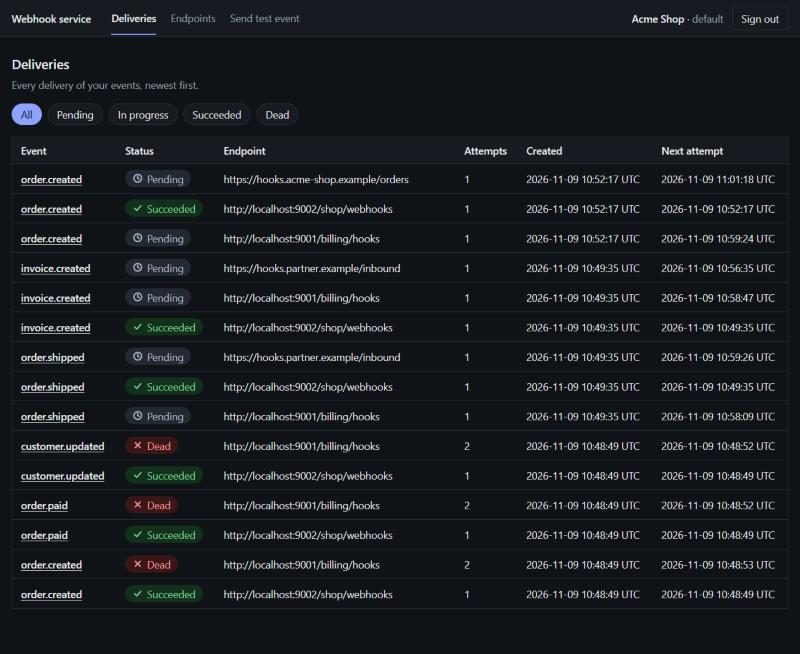
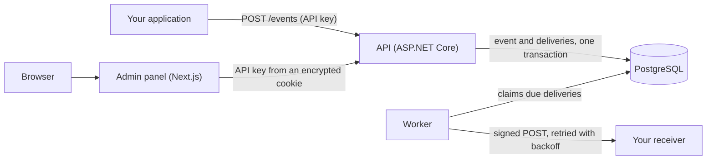
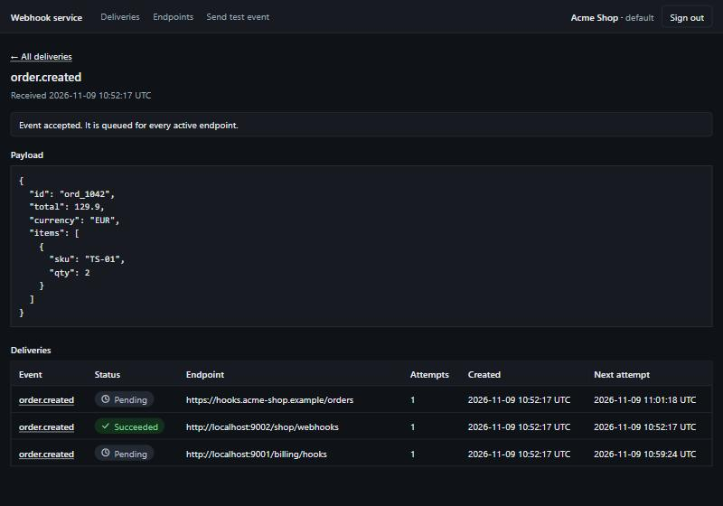
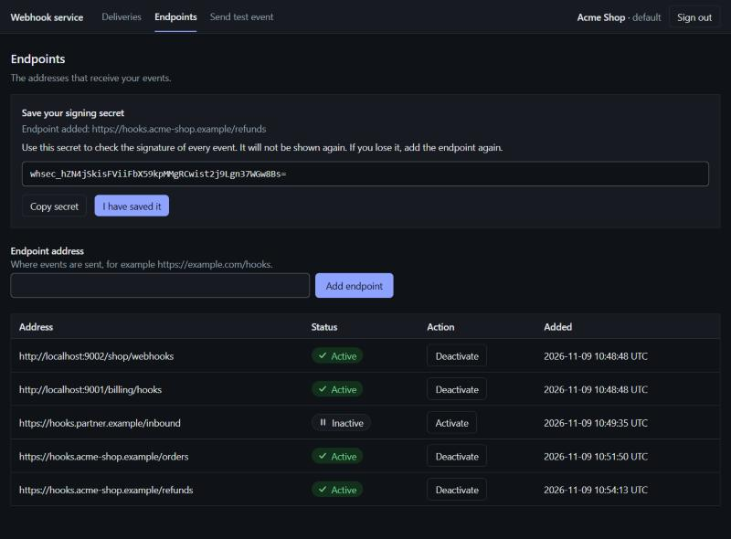
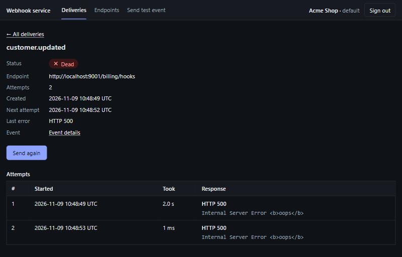
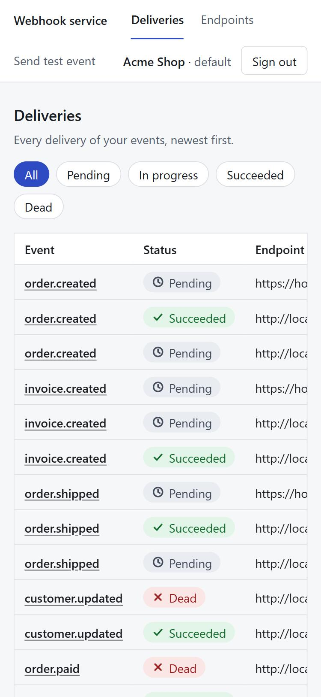

# Webhook Service

[](https://github.com/ridvan-byr/webhook-service/actions/workflows/ci.yml)

A self-hostable service that delivers webhooks reliably, with an admin panel to see what happened to every
delivery. Your application sends an event once. The service signs it, delivers it to every receiver you registered,
retries failures with growing delays, and keeps the full history, so a failed delivery can be found and sent again.



> Status: the API, the worker and the admin panel work end to end, and `docker compose up` starts all of it. Nothing
> here has been run in production yet. Changes are listed in the [changelog](CHANGELOG.md).

## Why

Sending an HTTP request to another system is easy. Doing it reliably is not:
receivers crash, time out, or return errors; the same event can be delivered
twice; and nobody can tell afterwards what actually happened. This project is a
from-scratch implementation of those problems, with the design decisions
written down in [`docs/decisions`](docs/decisions).

It is a learning and portfolio project. Hosted and mature alternatives such as
Svix exist; this project does not try to replace them.

## What it does

- **Reliable delivery.** At-least-once: an accepted event is never lost, because it and its deliveries are written
  in one database transaction ([ADR 0001](docs/decisions/0001-at-least-once-delivery.md)). Failures are retried with
  exponential backoff and jitter; after the last attempt a delivery is `Dead` and can be sent again by hand.
- **Several workers at once.** Workers claim due deliveries with `FOR UPDATE SKIP LOCKED`, so none is taken twice.
  A test runs two workers over 30 deliveries and checks that each is claimed exactly once
  ([ADR 0004](docs/decisions/0004-delivery-worker.md)).
- **Signed requests.** Every request carries `Webhook-Id`, `Webhook-Timestamp` and an HMAC-SHA256 `Webhook-Signature`,
  and the payload is stored and sent exactly as it was received. The id is stable, so receivers can ignore a repeat.
- **Idempotent intake.** Sending the same `Idempotency-Key` again never creates a second event.
- **Several tenants.** Each tenant has its own API keys (stored as hashes, compared in constant time) and only ever
  sees its own data ([ADR 0005](docs/decisions/0005-api-key-authentication.md)).
- **Safe to point at the internet.** The service connects only to public HTTPS addresses unless you allow otherwise,
  and checks the address at the moment it connects, so it cannot be used to reach internal systems
  ([ADR 0006](docs/decisions/0006-ssrf-protection.md)).
- **An admin panel** for deliveries, events and endpoints, with a security design of its own
  ([ADR 0007](docs/decisions/0007-admin-panel.md)).

## How it works



1. Your application sends an event to the API with its API key. The API stores the event and one delivery per active
   endpoint, in a single transaction, and answers `202`.
2. A worker claims each delivery that is due, signs the payload with the endpoint's secret and sends it.
3. A `2xx` answer ends the delivery as `Succeeded`. Anything else schedules the next attempt later; when the attempts
   run out the delivery is `Dead`.
4. In the panel, the browser never sees the API key: the panel's own server calls the API for it.

The queue is the `deliveries` table itself: the worker claims due rows with `FOR UPDATE SKIP LOCKED`. By default
that is all there is. Optionally RabbitMQ can announce due deliveries to the workers instead of every worker polling
the database; the database stays the source of truth either way (see [Using RabbitMQ](#using-rabbitmq-optional)).

## Try it

You need Docker. Nothing else is installed on your machine.

```bash
git clone https://github.com/ridvan-byr/webhook-service.git
cd webhook-service
cp .env.example .env
```

Open `.env` and fill in the two secrets (the file shows the command that makes each one). To send to the demo
receiver that comes with the project, also uncomment the last two settings, `ALLOW_PRIVATE_NETWORKS` and
`REQUIRE_HTTPS`: the receiver is on a private network and speaks plain http, which the service refuses by default
([why](docs/decisions/0006-ssrf-protection.md)). Do not do that on a server that can be reached from outside.

```bash
docker compose --profile demo up -d --build
```

Create a tenant. The answer contains its API key, **shown only once**:

```bash
curl -X POST http://localhost:5005/admin/tenants \
  -H "X-Admin-Key: <the ADMIN_API_KEY from .env>" \
  -H "Content-Type: application/json" \
  -d '{"name":"Demo"}'
```

Open http://localhost:3000, sign in with that key, add the endpoints `http://receiver:9000/ok` and
`http://receiver:9000/fail`, and send a test event. One delivery succeeds; the other is retried with growing delays
and finally gives up, and you can send it again from its page. `docker compose --profile demo logs -f receiver`
shows what the receiver got, including the signature headers.

```bash
docker compose --profile demo down      # stop; add --volumes to also delete the data
```

The API and the panel are published on `localhost` only, and PostgreSQL is not published at all. The panel sets a
`Secure` cookie, which browsers accept on `http://localhost` but not on another host name: to use it from other
machines, put it behind HTTPS. Compose needs the two secrets for every command, `down` included, so keep them in
`.env`. How the containers are built and what is checked is in
[ADR 0008](docs/decisions/0008-containers.md); `scripts/smoke.sh` runs those checks.

## Using RabbitMQ (optional)

Honestly: for this workload PostgreSQL alone is enough, and it is the default. A broker is one more thing to run and
to fail. It is here because it is a transport many teams already operate, and to show it done carefully: what it
changes is that one relay looks for due deliveries and announces them, so idle workers do not query the database at
all, and workers can be scaled without more database connections. It does **not** make deliveries faster; the relay
polls the database too.

```bash
# in .env: DELIVERY_TRANSPORT=RabbitMq and RABBITMQ_PASSWORD=<something long and random> (see .env.example)
docker compose --profile rabbitmq up -d --build
```

- A message carries only a delivery id, never a payload, address or secret. The worker still claims the delivery in
  the database, so a duplicate, late or invented message cannot make anything happen twice.
- If the broker is down, nothing is lost: events are still accepted, the deliveries stay due in the database and are
  announced when the broker returns. If it is down for good, set `DELIVERY_TRANSPORT=Postgres` and restart the worker;
  nothing needs migrating, and a worker of either kind can run next to the other.
- Messages that cannot be understood go to the queue `webhooks.deliveries.poison` instead of being retried.
- The broker is not published to the host. Its management page is on `http://127.0.0.1:15672` (user `webhooks`, your
  password) and only on this computer. There is no default password; the broker refuses to start without one. Outside
  a single machine, turn on TLS (`Delivery__RabbitMq__UseTls=true`).
- The design, the failure cases and what building it found are in
  [ADR 0010](docs/decisions/0010-rabbitmq-transport.md). `scripts/smoke.sh rabbitmq` runs the end-to-end check, and
  the unit and integration tests run against a real RabbitMQ in a container.

## Stack

- .NET (ASP.NET Core, background worker), EF Core
- PostgreSQL (queue via `FOR UPDATE SKIP LOCKED`), optionally RabbitMQ to announce due deliveries
- Next.js + TypeScript admin dashboard
- Docker (one command starts everything), GitHub Actions
- Later: SQL Server support, Azure deployment

## Layout

```
src/WebhookService.Core            domain model and interfaces
src/WebhookService.Infrastructure  persistence and delivery
src/WebhookService.Api             HTTP API
src/WebhookService.Worker          delivery worker
tests/WebhookService.Tests         tests
web                                admin panel (Next.js)
docs/decisions                     architecture decision records
Dockerfile, web/Dockerfile         container images (API, worker, panel)
docker-compose.yml                 the whole service; docker-compose.dev.yml is only the database
demo/receiver.js                   a receiver to try the service against
scripts/smoke.sh                   builds and runs everything and checks it (also run in CI)
```

## Run locally (for working on the code)

This starts only the database in Docker; the programs run on your machine. To run the whole service, see
[Try it](#try-it) above.

Requirements: .NET 8 SDK, Docker.

```bash
docker compose -f docker-compose.dev.yml up -d
dotnet build
dotnet test
dotnet run --project src/WebhookService.Api
```

Then open `/health`.

Persistence tests start their own PostgreSQL container with Testcontainers, so
Docker must be running when you run `dotnet test`.

## API

### Authentication

Every route except `/health` needs an API key: `Authorization: Bearer whk_...`.
Keys belong to a tenant, and a tenant only ever sees its own data
([ADR 0005](docs/decisions/0005-api-key-authentication.md)).

The operator creates tenants. This is switched off unless an admin key is configured, for
example with an environment variable (use a long random value, never commit it):

```bash
export Admin__ApiKey="<long random value>"
```

Create a tenant. The response contains its first API key, **shown only once**:

```bash
curl -X POST http://localhost:5000/admin/tenants \
  -H "X-Admin-Key: $Admin__ApiKey" \
  -H "Content-Type: application/json" \
  -d '{"name":"Acme"}'
```

A tenant can create more keys, list them (only the public prefix is shown) and revoke them:

| Request | Result |
|---|---|
| `POST /api-keys` | New key, shown once |
| `GET /api-keys` | Name, prefix, creation and revocation time of each key |
| `DELETE /api-keys/{id}` | Revokes a key at once (`409` if it is the key making the request) |

### Sending events

Register a receiver. The signing secret is returned once:

```bash
curl -X POST http://localhost:5000/endpoints \
  -H "Authorization: Bearer $API_KEY" \
  -H "Content-Type: application/json" \
  -d '{"url":"https://example.com/hook"}'
```

Send an event. Repeating the same `Idempotency-Key` never creates a second event:

```bash
curl -X POST http://localhost:5000/events \
  -H "Authorization: Bearer $API_KEY" \
  -H "Idempotency-Key: order-42" \
  -H "Content-Type: application/json" \
  -d '{"type":"order.created","payload":{"id":42}}'
```

Read what happened (all of these are limited to the caller's tenant):

| Request | Result |
|---|---|
| `GET /events/{id}` | The event, its payload and one summary per delivery |
| `GET /deliveries?status=Dead&limit=50` | Deliveries, newest first, each with its event type and endpoint address. `status` is `Pending`, `InProgress`, `Succeeded` or `Dead` |
| `GET /deliveries/{id}` | One delivery with every attempt: status code, duration, response snippet, error |
| `POST /deliveries/{id}/resend` | Queues a `Dead` delivery again with a fresh set of attempts (`409` for any other status) |
| `GET /me` | The tenant and the key behind the credentials. Never contains the key itself |

Switch an endpoint off, or on again. An inactive endpoint gets no new events; deliveries that
already exist are not affected:

```bash
curl -X PATCH http://localhost:5000/endpoints/$ENDPOINT_ID \
  -H "Authorization: Bearer $API_KEY" \
  -H "Content-Type: application/json" \
  -d '{"isActive":false}'
```

Run the delivery worker in a second terminal (the API applies the database migrations in
Development, so start it first):

```bash
dotnet run --project src/WebhookService.Worker
```

Every request to a receiver carries these headers, so the receiver can verify it:

| Header | Meaning |
|---|---|
| `Webhook-Id` | Event id. Identical on every retry, use it to detect duplicates |
| `Webhook-Timestamp` | Unix seconds when the attempt was sent |
| `Webhook-Signature` | `v1,` + base64 HMAC-SHA256 of `{id}.{timestamp}.{body}` using the endpoint secret |

Delivery is at-least-once. See [ADR 0004](docs/decisions/0004-delivery-worker.md).

### Where webhooks may be sent

Tenants choose the destination URL, so the service refuses to contact non-public addresses
(localhost, private networks, the cloud metadata address, ...). The check happens when the worker
connects, so it also holds against names that change their DNS answer later
([ADR 0006](docs/decisions/0006-ssrf-protection.md)). By default only `https` URLs are accepted.

Two settings control this, read by both the API and the worker. The defaults are the safe ones; the
Development settings relax them so that a receiver on `localhost` works. **Never enable them for a public
deployment:**

```json
"Security": { "AllowPrivateNetworks": false, "RequireHttps": true }
```

Run the worker in a network that cannot reach your internal services at all. The application check is
the second line of defence, not the first.

### Known limitations

- Only failed attempts to authenticate are limited (20 a minute per client by default, and the panel's sign-in
  10 a minute; [ADR 0009](docs/decisions/0009-failed-authentication-limit.md)). A valid tenant can still send as
  many requests and events as it likes. The count is kept in memory, so each running copy of the API counts for
  itself and it starts again with the process.
- A public address can still belong to the operator's own infrastructure, and ports are not restricted.
- No event-type filtering per endpoint.
- Switching an endpoint back on does not check its address again. The check made when the worker connects still
  applies, so a forbidden address is refused then, but it is not reported at the moment of switching on.

## Admin panel

A Next.js application in [`web/`](web) to see what happened to your events and to act on it. You sign in with the
API key of a tenant; the browser never sees that key (the panel calls the API from its own server and keeps the key
in an encrypted cookie).


- **Deliveries:** the newest deliveries, filterable by status, refreshing every five seconds. A page per delivery
  shows every attempt (when, how long, what the receiver answered) and a button to send a dead delivery again.
- **Events:** a page per event with its payload and what became of it, and a form that sends a test event. The
  payload is sent exactly as typed, because the signature covers those characters.
- **Endpoints:** list, switch on or off, and add. The signing secret of a new endpoint is shown once, in the
  response to adding it, and is never stored by the panel.
- Light and dark theme, usable on a phone, every state shown with an icon and a word as well as a colour, and
  accessibility checked with axe-core and the strict `jsx-a11y` lint rules.







The security design is the interesting part: a nonce-based Content-Security-Policy, an AES-256-GCM session cookie
(`__Host-` prefixed in production), every page and Server Action checking the session itself, and nothing from other
systems ever rendered as markup. The decisions, what was verified and how, the known limits, and why a few packages
are pinned are in [ADR 0007](docs/decisions/0007-admin-panel.md). The screenshots show made-up data from a local run.
Requirements: Node 20.9 or later. Node 20 reached end of life in April 2026, so Node 22 or 24 is recommended.

```bash
cd web
npm ci
npm run dev
```

Open http://localhost:3000 and sign in with the API key of a tenant (see Authentication above). The panel needs the
API running. Configuration is read from `web/.env.local`; copy `web/.env.example` and set `SESSION_SECRET`
(the file says how to make one). They are read on the server only and are never sent to the browser.

| Command | What it does |
|---|---|
| `npm test` | Unit and component tests (Vitest, React Testing Library, axe-core) |
| `npm run lint` | ESLint with the strict `jsx-a11y` accessibility rules |
| `npm run typecheck` | Generates the route types, then runs the TypeScript compiler |
| `npm run build` | Production build |
| `npm run audit:prod` | Fails on a known vulnerability in a package that ships with the panel |

### Database migrations

The EF Core CLI is a local tool, restore it once:

```bash
dotnet tool restore
```

Create a migration after changing the model:

```bash
dotnet tool run dotnet-ef migrations add <Name> --project src/WebhookService.Infrastructure --output-dir Persistence/Migrations
```

## Roadmap

- [x] v0.1 events, endpoints, signed delivery, retries, delivery history, manual re-send
- [x] v0.2 CI, API-key auth, SSRF protection, Next.js admin panel, one-command start with Docker Compose
- [x] v0.3 optional RabbitMQ transport ([design and what building it found](docs/decisions/0010-rabbitmq-transport.md))
- [ ] v0.4 SQL Server support
- [ ] v0.5 Azure deployment guide
